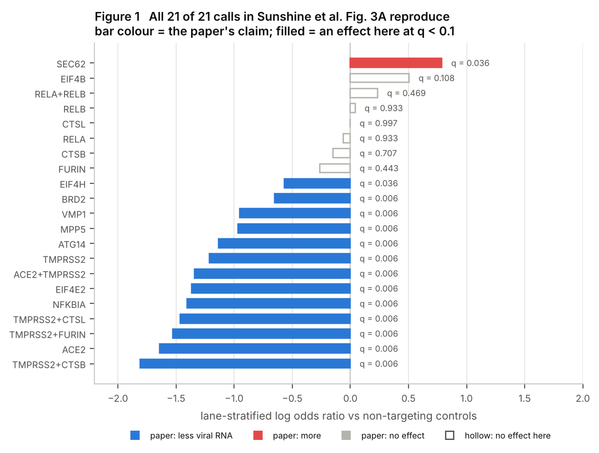
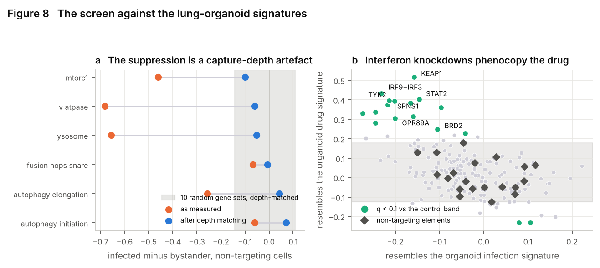

# A CRISPRi Perturb-seq screen, reproduced and reused

[](https://github.com/hbusra/crispri-perturbseq-sarscov2/actions/workflows/tests.yml)

I reanalysed the Calu-3 CRISPRi Perturb-seq screen of SARS-CoV-2 host factors
from [Sunshine et al., *Nature Communications* 14 (2023)](https://doi.org/10.1038/s41467-023-41788-4)
— 27,882 cells, 237 library elements, eight 10x channels — starting from the
processed matrix in [GSE208240](https://www.ncbi.nlm.nih.gov/geo/query/acc.cgi?acc=GSE208240)
and writing the analysis from scratch. Three things, in order: reproduce the
published findings, test the ones that do not hold up, and use the screen to ask
a question from my own work on SARS-CoV-2 infection in lung organoids.

---

## 1. The published findings reproduce

All 21 viral-load calls in the paper's Fig. 3A come back in the right direction —
the 14 reported hits at q < 0.05, the 7 reported non-hits failing q < 0.1 — from
an independent pipeline with a different statistical approach. The interferon
panel (Fig. 5A) reproduces too: all four novel hits (KEAP1, SPNS1, BRD2,
GPR89A/B) at q < 0.01, alongside the JAK-STAT axis.



Bar colour is the paper's claim; a filled bar is an effect here at q < 0.1.
Agreeing that a target has no effect is a reproduction too, so the hollow grey
bars count.

## 2. Three findings that change the interpretation

**The FURIN element never knocks FURIN down.** Target mRNA moves by +6% to −19%
across the three elements carrying FURIN, against a library median knockdown of
88%. The paper uses FURIN-alone as a negative result in its protease-redundancy
argument; on this data that arm is an uninterpretable reagent, not a negative.
MEPCE and LARP1 have the same problem.

**Blocking entry and limiting replication are different phenotypes, and the
published single "viral load" axis merges them.** Splitting it reclassifies
targets: ACE2 and the TMPRSS2 combinations block establishment (log OR −1.3 to
−1.8) but leave viral burden unchanged once a cell is infected, while MARK2 and
EXOC8 lower burden without reaching the establishment cut — host factors the
single-axis analysis cannot see. BRD2, TMPRSS2 and EIF4H move both.

**Two elements per gene is not the same as two independent reagents.** The 12
genes carried by separately cloned single-guide vectors agree at r = 0.55 on
knockdown. Pooling them with pairs that share guide design gives r = 0.74, a
number that mostly measures the same reagent twice.

Two more, in the detail: GPR89B on its own does not reproduce while GPR89A does
(the paper reports the paralogues together), and IRF3 alone does nothing — the
IRF9+IRF3 effect is attributable to IRF9. Both in [docs/results.md](docs/results.md).

## 3. Using the screen on a question from the organoid work

My organoid study ([*Nat Commun* 2025](https://www.nature.com/articles/s41467-025-61759-1))
puts virus-induced impairment of autophagic flux at the centre: NSP6 engages
PIP4K2C, and inhibiting PIP4K2C/PIKfyve reverses the block and is antiviral.
**PIP4K2C is not in this library**, so nothing here validates that target
directly. What the library does contain is some twenty members of the same
autophagy–endolysosomal module, which makes two questions answerable.



**Does infection suppress that module transcriptionally in Calu-3, as it does in
the organoids?** Taken as measured, emphatically yes — lysosomal, v-ATPase and
mTORC1 scores all drop sharply in infected cells. That signal does not survive
depth matching. Infected Calu-3 cells carry 9.4× fewer host UMIs than bystanders,
and once every cell is downsampled to a common depth the programme differences
fall inside the band spanned by ten random gene sets. The organoid data has the
same artefact with the opposite sign — there the viral-RNA-harbouring cells are
the deeper ones — which is a good argument for making cross-system claims on
perturbation effects rather than on infected-versus-bystander contrasts.

**Which perturbations move Calu-3 cells along the organoid signatures?** Each
element's profile, measured in bystander cells against non-targeting bystanders
at matched depth, correlated with the organoid signatures, with the null built
from the 20 control elements. 17 elements separate from that null on the drug
signature, and 15 of them are one axis: KEAP1 (ρ = 0.52), IRF9+IRF3, STAT2,
SPNS1, TYK2, IFNAR1/2, GPR89A/B, STAT1, BRD2. Knocking down interferon signalling
in Calu-3 reproduces the direction the drug moves infected organoid cells — and
the paper's four novel ISG regulators are all in that list.

The honest reading is that the compound reduces infection, so less interferon is
induced, and its 24 h transcriptional footprint is substantially a lowered
interferon tone. The screen does not make those genes drug targets. It does give
a short ranked list of genetically testable modulators of the same output, with
KEAP1 — oxidative-stress signalling rather than the JAK-STAT core — at the top.

Two negatives are worth as much. The autophagy–endolysosomal module shows no
match to the organoid infection signature (best q = 0.10), which is what you
expect if the mechanism is post-transcriptional, as the organoid paper argues
from flux and protein half-lives. And the cross-run infection contrast matches
nothing at all while the within-run one matches seven elements, so the batch
effect there does not merely add noise, it removes the signal.

---

## How hits are called

- **Infection state** from a two-component mixture on log10 viral fraction
  (29.2% infected, 61.1% bystander, 9.7% in an ambiguous band, held out).
- **Two phenotypes.** Infection *establishment* is a Mantel–Haenszel odds ratio
  stratified by 10x channel (30 of 164 elements at q < 0.1). Viral *burden given
  infection* is a negative-binomial GLM with `log(host UMI)` as the offset
  (5 of 149). Never total UMI, which contains the outcome.
- **Significance** from resampling the control cells: 2,000 lane-matched
  pseudo-elements per element. Not a permutation of perturbation labels.
- **Knockdown** measured in bystander cells only, since shutoff flatters every
  ratio in infected cells.
- **Lane** is a blocking factor throughout: channels 5–8 carry 1.4× the infection
  rate of channels 1–4.

Full estimands and nulls: [docs/statistical_methods.md](docs/statistical_methods.md).
All results and figures: [docs/results.md](docs/results.md).

**Supporting analyses, none of which changed a conclusion.** QC — classifier
agreement, knockdown, construct concordance, lane structure — is in
[notebooks/qc.ipynb](notebooks/qc.ipynb). Sensitivity analyses — lane as a random
intercept instead of a stratum (effect sizes correlate at r = 0.9999), the burden
denominator, the infection classifier, null calibration, and what the ambiguous
band turns out to be — are in [notebooks/sensitivity.ipynb](notebooks/sensitivity.ipynb).

## What this design cannot claim

The eight `gem_group` values are 10x channels from one infection experiment, not
eight infections, so no p-value here speaks to reproducibility across
experiments. 47 of 237 elements have fewer than 55 cells, mostly essential genes
whose knockdown kills cells, so their absence from the hit list is systematic.
And the organoid comparison is a correlation of transcriptional profiles across
two systems, not evidence of a shared mechanism.

## Repository layout

```
scripts/
  00_download.sh … 01_build_anndata.py    GEO download; AnnData with guide calls and lanes
  02_qc.py  03_infection.py  04_guide_qc.py       QC, infection calling, knockdown
  05_viral_load.py  06_isg.py                     the paper's Fig. 3A and Fig. 5A
  07_hit_calling.py                               MH odds ratios, NB GLM, control null, FDR
  08_representation.py                            coverage and resolution
  09_infected_vs_bystander.py                     effects by infection state
  10_figures.py                                   every figure, from the tables only
  11_mixed_effects.py                             lane random intercept vs stratification
  12_borderline_cells.py                          what the ambiguous band is
  13_infection_programs.py                        autophagy programmes, depth-matched
  14_organoid_signature_match.py                  elements against the organoid signatures
notebooks/   qc.ipynb, sensitivity.ipynb
docs/        results.md, statistical_methods.md, RUNBOOK.md
tests/       test_estimators.py  (12 tests, run in CI)
results/     tables/ (every number quoted here) and figures/
```

## Running it

```bash
conda env create -f environment.yml && conda activate perturbseq-cov2
bash scripts/00_download.sh data/raw            # ~1.2 GB from GEO
python scripts/01_build_anndata.py --raw data/raw --out data
for s in 02_qc 03_infection 04_guide_qc 05_viral_load 06_isg 07_hit_calling \
         08_representation 09_infected_vs_bystander 10_figures 11_mixed_effects \
         12_borderline_cells 13_infection_programs; do
    python scripts/$s.py
done
python -m pytest tests -q                       # 12 estimator tests, ~10 s
```

`14_organoid_signature_match.py` additionally needs the organoid differential
expression tables, which are not public and are not in this repository.

About 14 minutes on 4 cores, 11 of which are the one-off parse of the
337-million-entry matrix in `01`; that is cached, so reruns take under 3 minutes.
[docs/RUNBOOK.md](docs/RUNBOOK.md) lists each step with the numbers it prints.

## Data

GEO [GSE208240](https://www.ncbi.nlm.nih.gov/geo/query/acc.cgi?acc=GSE208240),
deposited by the authors of the original study; nothing in `data/` is committed.
I start from their per-cell guide assignments, so this is a reanalysis from the
processed matrix rather than from FASTQs.

> Sunshine S, Puschnik AS, Replogle JM, Laurie MT, Liu J, Zha BS, Nuñez JK,
> Byrum JR, McMorrow AH, Frieman MB, Winkler J, Qiu X, Rosenberg OS, Leonetti MD,
> Ye CJ, Weissman JS, DeRisi JL, Hein MY.
> Systematic functional interrogation of SARS-CoV-2 host factors using Perturb-seq.
> *Nature Communications* 14 (2023). doi:10.1038/s41467-023-41788-4

## Licence

Code is MIT licensed (see [LICENSE](LICENSE)). The GSE208240 data and the
original figures remain under their own terms.
