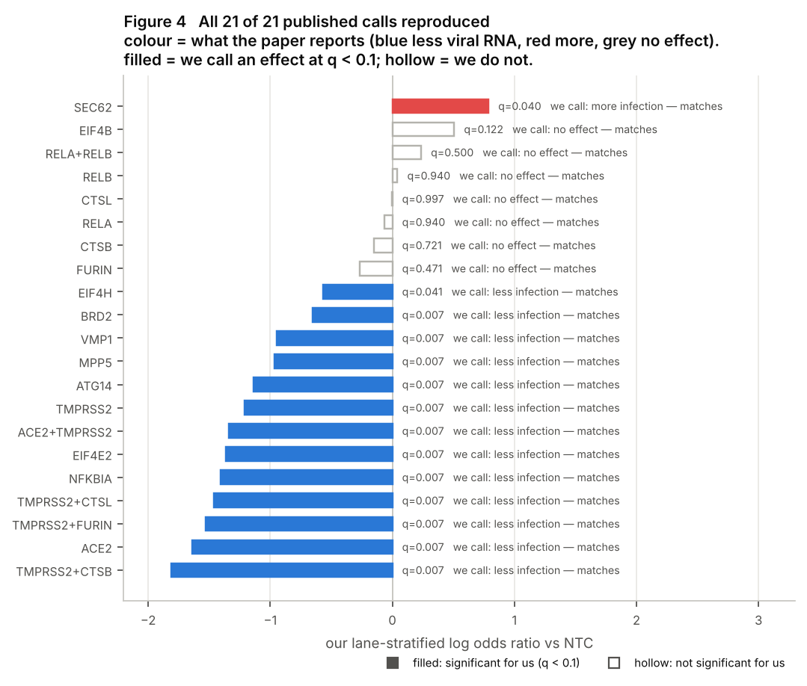
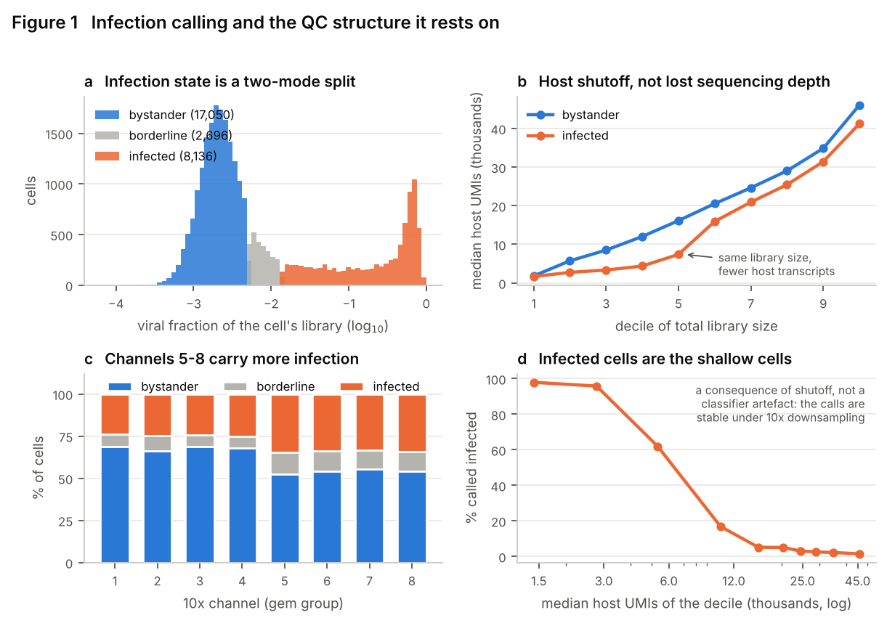
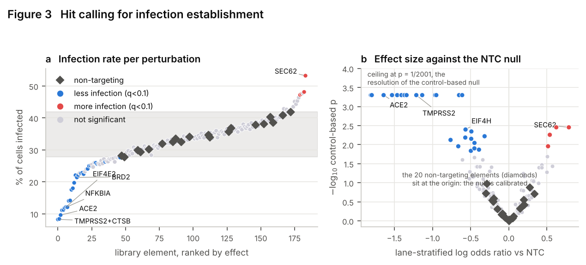
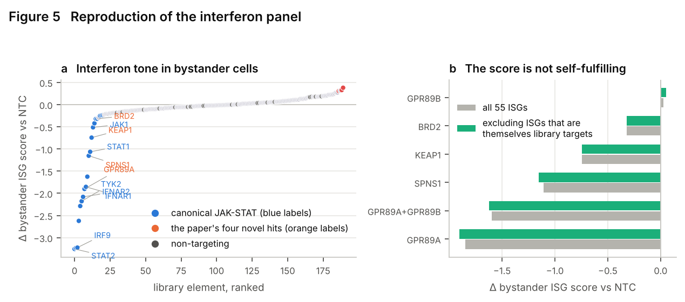
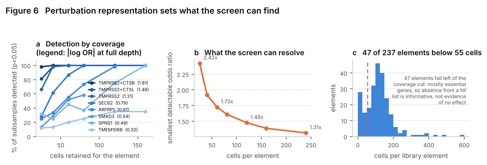
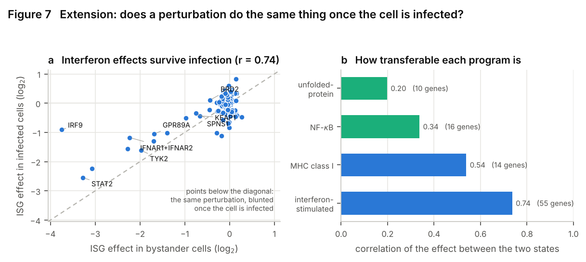

# A guide-aware QC and hit-calling workflow for pooled single-cell perturbation screens

Validated by reproducing a published CRISPRi Perturb-seq screen of SARS-CoV-2 host
factors in Calu-3 cells ([Sunshine et al., *Nature Communications* 14, 2023](https://doi.org/10.1038/s41467-023-41788-4);
data [GSE208240](https://www.ncbi.nlm.nih.gov/geo/query/acc.cgi?acc=GSE208240)).

**All 21 of the published viral-load calls are reproduced in the right direction**,
including the 14 reported hits and the 7 targets the paper reports as having no
effect, using an independently written pipeline and a different statistical
approach from the original. The interferon panel reproduces as well: all four of
the paper's novel hits (GPR89A/B, KEAP1, SPNS1, BRD2) and the canonical JAK-STAT
axis come back at q < 0.01.

The point of the repository is not the reproduction. It is the machinery around it:
how perturbation screens get QC'd, what a defensible null looks like when there is
no biological replication, and how far a hit list can be trusted given the
screen's coverage.

---

## The question

> How reliably can we identify perturbations that change an infection phenotype in
> a pooled single-cell screen, and how do we know the hits are real?

Three things have to be true before a hit list means anything, and each gets its
own script:

| | Question | Script | Answer here |
|---|---|---|---|
| 1 | Did the perturbation work? | `04_guide_qc.py` | median 88% on-target knockdown; 76% of element–gene pairs clear 75%; **FURIN does not knock down at all** |
| 2 | Is the phenotype real, or a measurement artefact? | `03_infection.py` | three independent classifiers agree ≥ 99.3%; calls stable to 10× downsampling |
| 3 | Is the effect bigger than control-to-control noise? | `07_hit_calling.py` | lane-matched empirical null built from 22 non-targeting elements; 0/22 false positives |

---

## Headline results

### The screen reproduces



**How to read this.** Bar colour is what the *paper* claims; fill is what *we*
call. "Reproduced" means our call agrees with the paper's, and that includes
agreeing that a target has no effect — so the seven grey bars are reproductions
too, not failures.

The cutoff for calling an effect is **q < 0.1**, Benjamini-Hochberg across the 184
elements tested for this phenotype, on permutation p-values. Nothing else is a
threshold: bar length on its own is not a claim, which is why the targets we call
null are drawn hollow however long their bar is.

On that cutoff the 14 reported hits all clear q < 0.05 and the 7 reported non-hits
all fail it. The closest call is EIF4B: a 1.66× increase in infection odds on 111
cells, with a raw permutation p of 0.02 that becomes q = 0.12 once corrected across
184 elements. So it is the multiple-testing correction, not the test, that makes it
null — which is the honest way to describe it, and the one target here where a
larger screen could plausibly change the answer. It still agrees with the paper,
which also reports no effect.

### Infection calling, and what it rests on



The viral fraction of a cell's library is cleanly bimodal, so the infected/bystander
split does not need a hand-chosen cutoff. Three things are checked rather than
assumed:

- **Host shutoff is biology, not lost depth.** Within deciles of *total* library
  size, infected cells still carry far fewer host transcripts (panel b). The
  difference is composition, not sequencing.
- **The classifier is not depth-driven.** Infected cells are the shallow cells
  (panel d), which would be alarming if it were an artefact. It is not: binomially
  downsampling the entire library tenfold changes 0.4% of calls.
- **Channels are not interchangeable.** 10x channels 5–8 carry about 1.4× the
  infection rate of channels 1–4 (panel c), reflecting the paper's pulsed and
  non-pulsed conditions. Lane is therefore a stratum in every model and every
  permutation downstream, not a nuisance to be ignored.

### Hit calling



Two estimands are kept apart, because a knockdown that blocks entry and one that
limits replication are different findings:

- **Infection establishment** — the odds of a cell being infected rather than
  bystander, as a Mantel–Haenszel odds ratio stratified by 10x channel. 30 of 164
  testable elements are significant at q < 0.1.
- **Viral burden given infection** — viral UMIs per host UMI among infected cells,
  as a negative-binomial GLM with `log(host UMI)` as an offset. 5 of 149 elements
  are significant.

The offset is host UMI and never total UMI. Total UMI contains the viral counts
being modelled and is itself depressed by infection, so conditioning on it would
mean conditioning on the outcome.

Significance comes from an empirical null, not from a Wald p-value: for each
element, 2,000 pseudo-elements are drawn from the pooled non-targeting cells,
matched to that element's cell count in each lane. Running the 22 real
non-targeting elements through the same pipeline yields **zero** hits at q < 0.1.

### The interferon panel



Restricted to bystander cells, as in the paper, because infected cells suppress
interferon signalling and a mixed population mostly measures each element's
infected fraction instead. 23 of 170 elements move the bystander ISG score at
q < 0.1. The ranking is led by the JAK-STAT axis (STAT2, IRF9, IFNAR1/2, TYK2,
STAT1, JAK1) and recovers all four of the paper's novel hits.

Panel b handles a trap the published description leaves open: twelve genes in the
ISG set are themselves CRISPRi targets in this library, so knocking one down
mechanically lowers any score containing it. Recomputing without them changes
nothing material, which is the result you want but not one you can assume.

### What the screen can and cannot resolve



This is deliberately *not* framed as a power analysis. There is one infection
experiment here, so there is no replicate structure from which to estimate a
between-experiment variance, and any power number would be a statement about
cell-level sampling noise dressed up as a statement about the experiment. What can
be said honestly:

- Effect estimates are unbiased down to 25 cells per element; **detection** is what
  degrades. An element with |log OR| = 1.8 is found in 98% of 25-cell subsamples;
  one with |log OR| = 0.32 is found in 35% of subsamples even at 160 cells.
- From the null alone, the screen resolves a 1.75× odds ratio at 60 cells per
  element and 1.31× at 240.
- 47 of 237 elements fall below the 55-cell cut, mostly essential genes whose
  knockdown kills cells. Their absence from the hit list is informative, not
  evidence of no effect — and it is a systematic gap, not a random one.

### Extension: does a perturbation do the same thing once the cell is infected?



Every per-element phenotype above is measured on one population at a time. Comparing
pseudobulk effect profiles between an element's infected and bystander cells shows
that interferon effects largely survive infection (r = 0.74 across elements) but are
consistently **blunted** — nearly every point sits below the diagonal, consistent
with viral suppression of the interferon axis compressing the dynamic range the
perturbation acts on. Antigen-presentation effects transfer less well (r = 0.54) and
NF-κB and unfolded-protein effects barely at all (0.34, 0.20).

This is a descriptive comparison of effect profiles, not a formal interaction test.
An interaction test needs a perturbation-by-state term, and with one infection
experiment its variance component is not estimable.

---

## Findings that differ from the published account

Reproduction is only useful if the discrepancies are reported too.

**FURIN knockdown fails.** The paper reports that TMPRSS2 combined with FURIN, CTSB
or CTSL reduces viral RNA while FURIN or the cathepsins alone do not, and reads this
as protease redundancy. In our hands the FURIN element shows **no knockdown of
FURIN** (−19% to +6% across the three elements carrying it, versus a library median
of 88%). The redundancy interpretation may well be right, but this dataset cannot
support it: the single-gene FURIN arm is an uninterpretable reagent, not a negative
result. The same holds for MEPCE and LARP1. This is exactly what step 1 of the
QC table is for.

**GPR89B alone does not reproduce; GPR89A does.** The paper reports GPR89A/B
together. Here GPR89A (q < 0.01) and the GPR89A+GPR89B dual element (q < 0.01) both
lower the bystander ISG score, while the GPR89B single element does not (rank 124 of
170, q = 0.82). GPR89A and GPR89B are near-identical paralogues, so this is most
likely a guide-level difference rather than a biological one, but it is a real
difference between the elements.

**IRF3 alone does not reproduce.** IRF3 is listed in the paper's interferon pathway
group, but its single element sits at rank 134 of 170 with no effect on the
bystander ISG score, while IRF9+IRF3 is third. The effect in the dual element is
attributable to IRF9.

---

## What this design cannot claim

Stated here rather than buried, because it is the thing most likely to be
overclaimed in a screen reanalysis.

The eight `gem_group` values are 10x channels from a **single infection
experiment**, not eight independent infections. The permutation null controls for
cell-level and channel-level sampling noise. It does **not** establish
reproducibility across independent biological experiments, and no p-value in this
repository should be read that way. The internal replication that *is* available —
41 genes carried by two independent library elements, which agree at r = 0.74 on
knockdown — is reported as such.

---

## Repository layout

```
scripts/
  00_download.sh              GEO download, checksums, unpacking
  01_build_anndata.py         AnnData with host/viral/lenti split, guide calls, lanes
  02_qc.py                    cell QC, lane structure, element representation
  03_infection.py             infection classification (3 rules) + depth sensitivity
  04_guide_qc.py              on-target knockdown, two-element reproducibility
  05_viral_load.py            descriptive reproduction of the published Fig. 3A
  06_isg.py                   reproduction of the published Fig. 5
  07_hit_calling.py           MH odds ratios, NB GLM, NTC permutation null, FDR
  08_representation.py        subsampling curves, resolution, underpowered elements
  09_infected_vs_bystander.py the extension
  10_figures.py               every figure, drawn from the tables only
  _common.py                  paths, gene sets, BH-FDR
  _hitcalling_core.py         the estimators and nulls shared by 07 and 08
docs/
  statistical_methods.md      estimands, nulls, and what each one licenses
  RUNBOOK.md                  every command, in order, with expected output
results/tables/               every number in this README, as .tsv
results/figures/              the figures above
```

Analysis and plotting are kept apart: `10_figures.py` reads only from
`results/tables/`, so any figure can be regenerated or redrawn without rerunning a
single statistic.

## Running it

```bash
conda env create -f environment.yml && conda activate perturbseq-cov2
bash scripts/00_download.sh data/raw            # ~1.2 GB from GEO
python scripts/01_build_anndata.py --raw data/raw --out data
for s in 02_qc 03_infection 04_guide_qc 05_viral_load 06_isg \
         07_hit_calling 08_representation 09_infected_vs_bystander 10_figures; do
    python scripts/$s.py
done
```

About 14 minutes end to end on 4 cores, of which 11 are the one-off parse of the
337-million-entry matrix in `01`; that result is cached, so every rerun of the
analysis is under 3 minutes. Peak memory is about 6 GB, also in `01`. See
[docs/RUNBOOK.md](docs/RUNBOOK.md) for the step-by-step version with the expected
output at each stage.

## Data

Raw and processed data are from GEO [GSE208240](https://www.ncbi.nlm.nih.gov/geo/query/acc.cgi?acc=GSE208240),
deposited by the authors of the original study. Nothing in `data/` is committed.
The authors' own per-cell guide assignments (`cell_identities.csv`) are used as the
starting point, so this is a reanalysis from the processed matrix rather than from
FASTQs.

If you use the data, cite the original study:

> Sunshine S, Puschnik AS, Replogle JM, Laurie MT, Liu J, Zha BS, Nuñez JK,
> Byrum JR, McMorrow AH, Frieman MB, Winkler J, Qiu X, Rosenberg OS, Leonetti MD,
> Ye CJ, Weissman JS, DeRisi JL, Hein MY.
> Systematic functional interrogation of SARS-CoV-2 host factors using Perturb-seq.
> *Nature Communications* 14 (2023). doi:10.1038/s41467-023-41788-4

## Licence

Code in this repository is MIT licensed (see [LICENSE](LICENSE)). That covers the
code only: the GSE208240 data and the original publication's figures remain under
their own terms, and the reproduction above is of published results that belong to
their authors.
