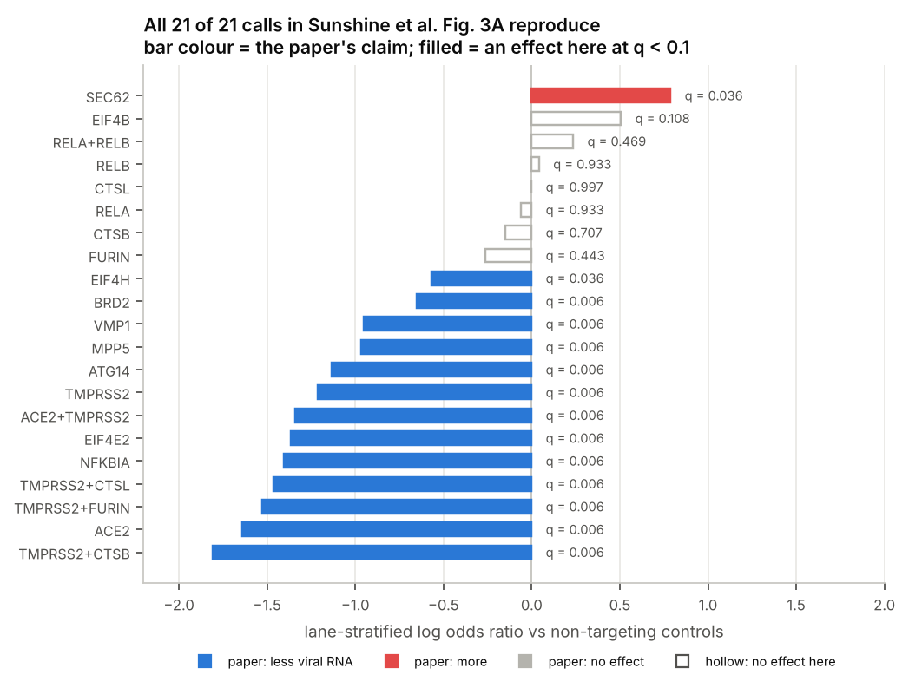
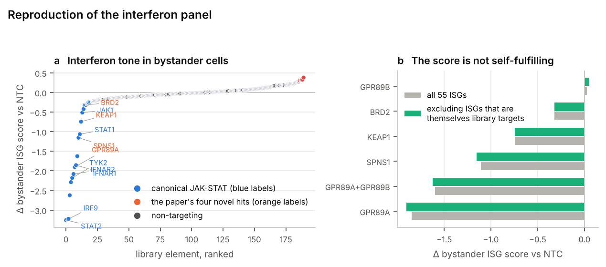
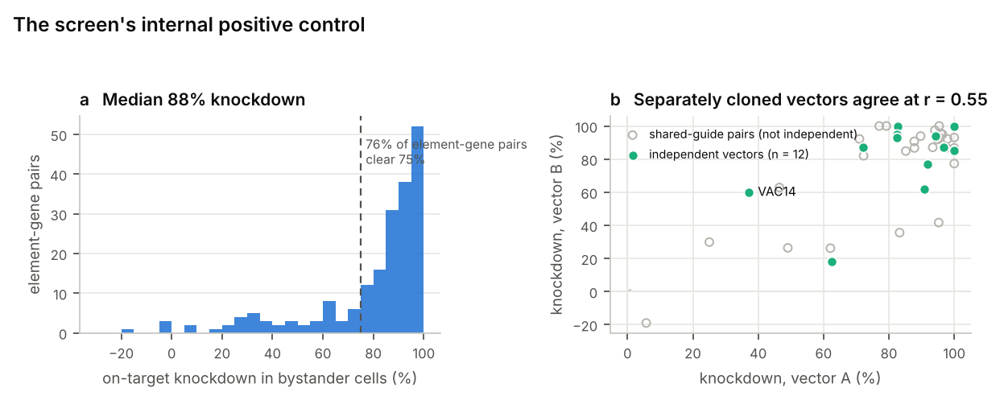
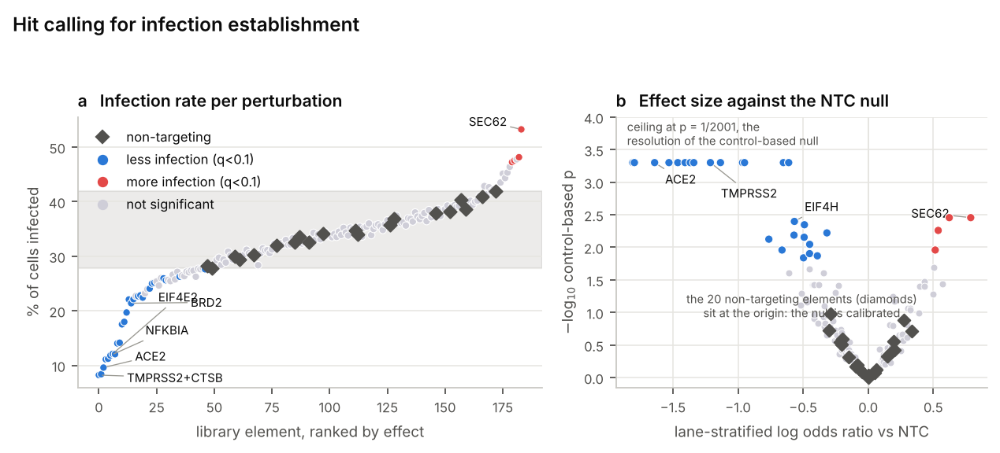
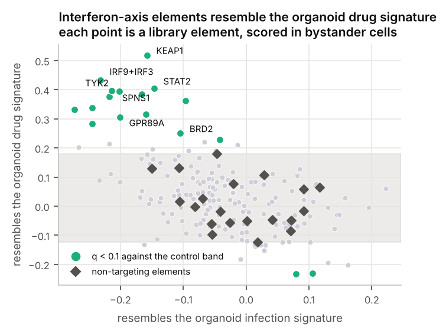

# Overview

A reanalysis of the Calu-3 CRISPRi Perturb-seq screen of SARS-CoV-2 host factors
([Sunshine et al., *Nat Commun* 14, 2023](https://doi.org/10.1038/s41467-023-41788-4),
GEO [GSE208240](https://www.ncbi.nlm.nih.gov/geo/query/acc.cgi?acc=GSE208240)):
27,882 guide-assigned cells, 237 library elements, eight 10x channels, one
infection experiment. I came to it from the organoid side: I work on SARS-CoV-2
in lung organoids and wanted to know whether a published Calu-3 screen could say
anything about the programs I see there. Reproducing the paper's calls came
first, and the problems below turned up on the way.

---

### 1. The published calls reproduce

All 21 viral-load calls in the paper's Fig. 3A come back in the right direction:
14 reported hits at q < 0.05, 7 reported non-hits not significant here. Effects
are lane-stratified Mantel–Haenszel odds ratios against the 22 non-targeting
elements, with p-values from a lane- and size-matched control null.

→ [notebook/03_hit_calling](../notebook/03_hit_calling.ipynb) ·
[03_concordance.tsv](../results/tables/03_concordance.tsv)

### 2. The interferon panel reproduces, with one correction

The bystander ISG axis (paper Fig. 5A) returns the canonical JAK–STAT pathway
first, and all four of the paper's novel regulators — GPR89A, KEAP1, SPNS1,
BRD2 — at q < 0.01. GPR89B on its own does not reproduce; the GPR89A element and
the dual-targeting element do, so the gene-level claim stands and the
single-element one does not. The score is recomputed excluding ISGs that are
themselves library targets, because otherwise the panel is partly
self-fulfilling.

→ [notebook/04_interferon](../notebook/04_interferon.ipynb) ·
[04_isg_by_element.tsv](../results/tables/04_isg_by_element.tsv)

### 3. One of the reagents does not work

The elements carrying FURIN move FURIN by +6% to −19%, against a library median
of 88% knockdown. The paper's protease-redundancy argument reads the single-gene
FURIN arm as a negative result, and a reagent that does not knock the gene down
cannot carry that. MEPCE and LARP1 look the same.

The same notebook shows that "two elements per gene" is not two independent
reagents: the 12 genes carried by separately cloned single-guide vectors agree at
r = 0.55, while pooling them with pairs that share guide design gives 0.74.

→ [notebook/02_knockdown](../notebook/02_knockdown.ipynb) ·
[02_knockdown.tsv](../results/tables/02_knockdown.tsv)

### 4. Establishment and burden are different phenotypes

The published single viral-load axis merges whether a cell gets infected with how
much virus it carries. Separated: ACE2 and the TMPRSS2 combinations block
establishment so thoroughly that too few infected cells remain to estimate burden
at all (12 for ACE2), while EXOC8 lowers burden with no effect on establishment
(q = 0.02 against q = 0.94). TMPRSS2 and BRD2 move both.

→ [notebook/03_hit_calling](../notebook/03_hit_calling.ipynb) ·
[03_hits_infection.tsv](../results/tables/03_hits_infection.tsv),
[03_hits_burden.tsv](../results/tables/03_hits_burden.tsv)

### 5. The screen against my lung-organoid signatures

Can host-factor perturbation signatures from this screen help interpret the
programs I see in infected lung organoids? Scoring every element's bystander
profile against my organoid contrasts at matched depth: 17 elements separate from
the control band on the drug signature, and 14 of them are the interferon axis —
KEAP1 (ρ = 0.52), IRF9 and IRF9+IRF3, STAT1, STAT2, TYK2, IFNAR1 and IFNAR2,
GPR89A, SPNS1, BRD2 — including all four of the paper's novel ISG regulators.
So elements that knock down interferon signalling have bystander profiles
resembling the drug signature from infected organoids. This is a rank correlation
between two systems: it points at the interferon axis as a shared transcriptional
response, and says nothing about how the drug acts.

PIP4K2C is not in this library, so nothing here validates that target directly,
and the autophagy–endolysosomal elements show no significant match (best
q = 0.10 across the two axes, VAC14 at ρ = 0.22). Coverage is not the reason —
those elements carry a median of 99 cells against a library median of 77 — so
either the effect is small or it is something this transcriptional comparison
cannot see.

→ [notebook/07_organoid_signatures](../notebook/07_organoid_signatures.ipynb) ·
[07_element_signature.tsv](../results/tables/07_element_signature.tsv)

---

### What the conclusions were checked against

| Check | Result | Where |
| --- | --- | --- |
| Infection calling, four classifiers | effect sizes agree at r = 0.99; 23 of 31 hits called under both | [notebook/01](../notebook/01_qc_and_infection_calling.ipynb) |
| Host shutoff vs lost sequencing depth | shutoff: infected cells carry fewer host UMIs at matched library size | [notebook/01](../notebook/01_qc_and_infection_calling.ipynb) |
| Choice of denominator for burden | holds under host genes and a no-offset depth band; only total UMI drifts | [notebook/03](../notebook/03_hit_calling.ipynb) |
| Lane as a random intercept instead of a stratum | r = 0.9999, hit-list Jaccard 0.87 | [notebook/08](../notebook/08_sensitivity_mixed_effects.ipynb) |
| What the screen can resolve | the weakest real hits are detected in 20-45% of subsamples at 60-120 cells | [notebook/05](../notebook/05_coverage_and_resolution.ipynb) |
| Cells between the two modes | look like early infection rather than doublets; published ISG result unaffected | [notebook/06](../notebook/06_infection_state.ipynb) |
| Estimators against statsmodels and simulation | 12 tests, run in CI | [tests/test_estimators.py](../tests/test_estimators.py) |

Methods — estimands, nulls, testing families — are in
[statistical_methods.md](statistical_methods.md). Every number above comes from a
table in [results/tables](../results/tables), numbered by the notebook that
writes it.
