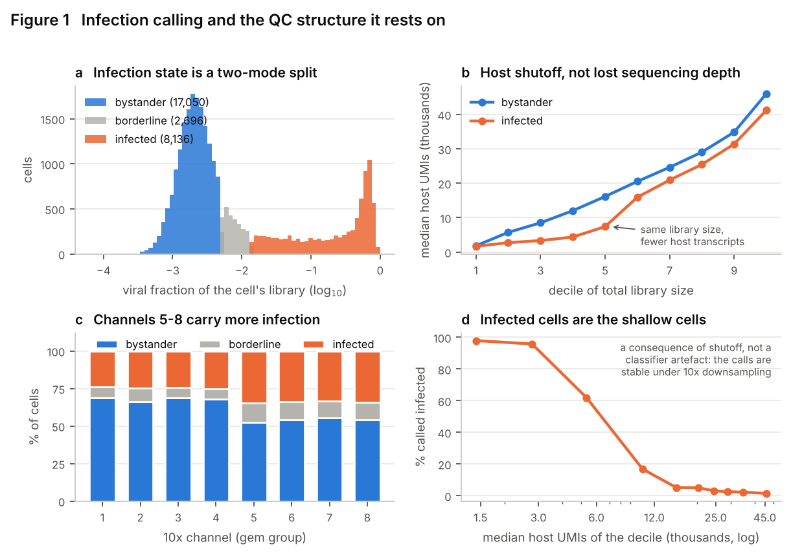
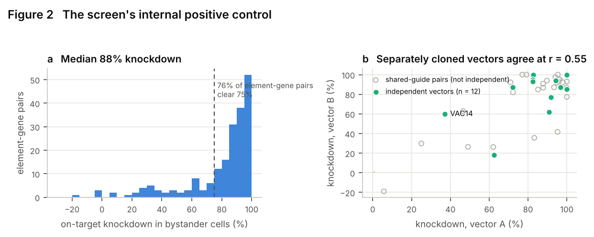
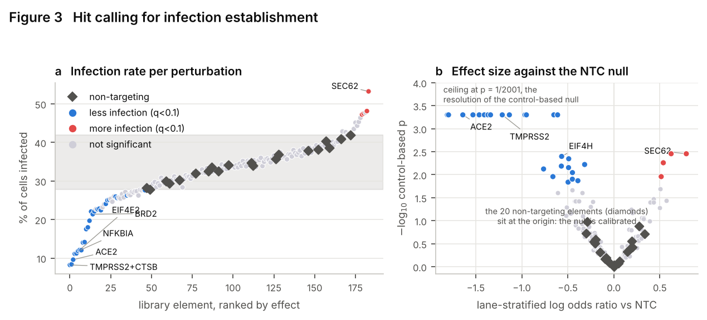
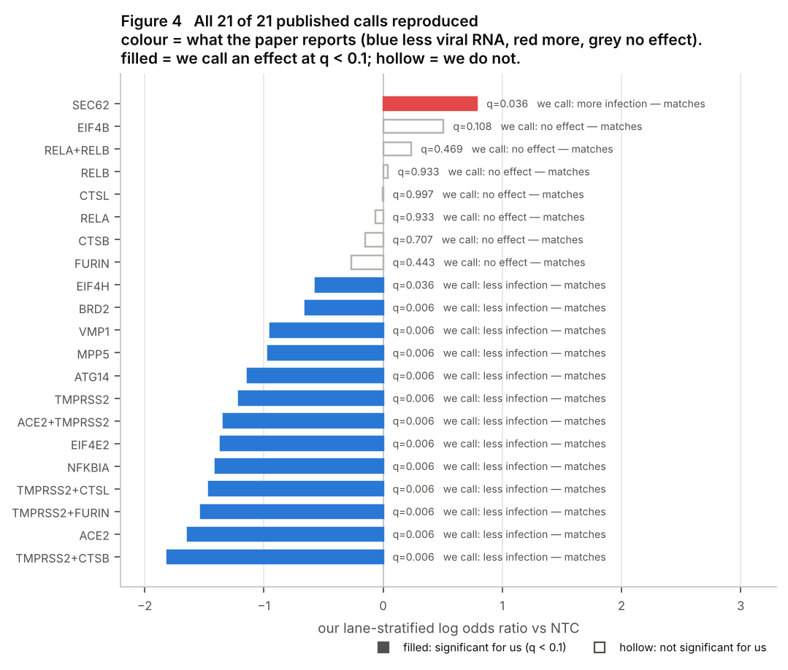
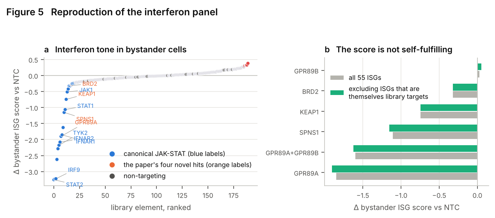
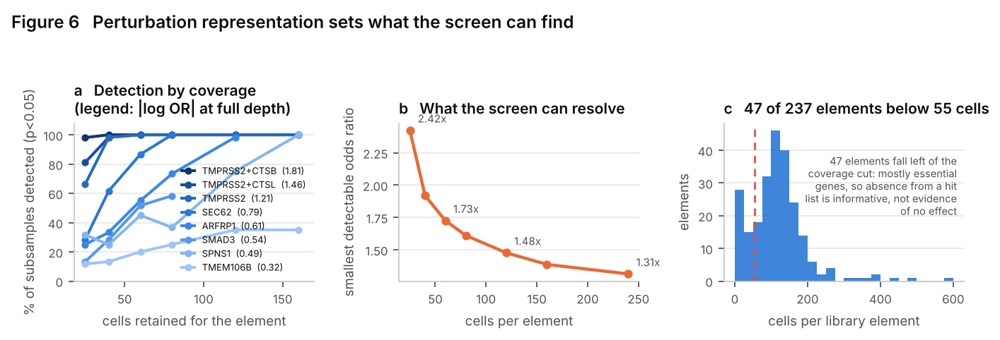
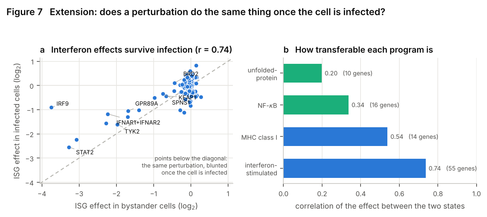

# Results in detail

The [README](../README.md) carries the headline numbers. This document is the
long version: every figure, what it rests on, where this reanalysis disagrees
with the published account, and what the design cannot support. The statistical
definitions behind it are in [statistical_methods.md](statistical_methods.md);
every number here is in `results/tables/` as a `.tsv`.

---

## 1. Infection calling, and what it rests on

The viral fraction of a cell's library is cleanly bimodal, so the
infected/bystander split does not need a hand-chosen cutoff: a two-component
Gaussian mixture on log10 viral fraction gives 29.2% infected, 61.1% bystander
and 9.7% borderline (the borderline band is excluded from both populations
rather than forced into one).

Three things are checked rather than assumed.

- **Host shutoff is biology, not lost depth.** Within deciles of *total* library
  size, infected cells still carry far fewer host transcripts (panel b). The
  difference is composition, not sequencing.
- **The classifier is not depth-driven.** Infected cells are the shallow cells
  (panel d), which would be alarming if it were an artefact. It is not:
  binomially downsampling the entire library tenfold changes 0.45% of calls.
- **Channels are not interchangeable.** 10x channels 5–8 carry about 1.4× the
  infection rate of channels 1–4 (panel c), reflecting the paper's pulsed and
  non-pulsed conditions. Lane is therefore a stratum in every model and every
  resampling null downstream, not a nuisance to be ignored.

### Four classifiers, including the paper's literal rule

| rule | infected | agreement with the mixture |
|---|---|---|
| two-component mixture on log10 viral fraction (**primary**) | 29.2% | — |
| per-gene ambient background, viral gene above background | 30.7% | 99.3% |
| fixed cutoff, viral fraction > 0.009 | 32.2% | 99.9% |
| the published rule taken literally: any viral gene ≥ mean + 2 SD of a reconstructed uninfected reference | 6.2% | 74.6% |

The first three agree almost completely, and the downstream hit list is robust
to swapping between them (Jaccard 0.74 on the infection hit set; effect-size
correlation 0.99).

The fourth is reported because honesty requires it, not because it argues the
published rule is wrong. The rule needs a guide-free uninfected reference, and
the reference that can be reconstructed from the processed GEO matrix is
contaminated: 11.6% of the cells in it are themselves called infected by the
mixture. A background mean inflated by real infected cells pushes the threshold
up and calls only 6.2% of cells infected. This is a limitation of what can be
rebuilt from the deposited matrix, and it is the reason the primary classifier
does not depend on an external reference at all.

---

## 2. Did the perturbation work?

On-target knockdown is the screen's internal positive control: a CRISPRi element
that does not lower its own target's mRNA cannot be interpreted, and leaving it
in a hit list inflates the false-positive rate.

Measured in bystander cells only (infected cells lose most of their host mRNA to
NSP1-driven shutoff, which makes every knockdown look better than it is), with a
pseudobulk estimator (summed target counts over summed host counts, relative to
the same ratio in non-targeting cells):

- median **88%** knockdown across 197 element–gene pairs with ≥ 20 bystander cells
- **76%** of pairs clear 75%; 46% clear 90%
- 4 pairs are negative, i.e. no knockdown at all

### Construct reproducibility: 12 genes, not 41

The library contains two quite different situations, and pooling them inflates
the agreement:

| pair type | n genes | Pearson r | Spearman ρ | median \|difference\| |
|---|---|---|---|---|
| **independent vectors** (elements 216–239, two separately cloned single-guide vectors) | **12** | **0.55** | 0.36 | 0.148 |
| single-gene element vs a two-gene combination containing it | 24 | 0.55 | 0.20 | 0.089 |
| genes appearing in three or more elements | 5 | 0.97 | 1.00 | 0.048 |

Only the first row is a reagent-to-reagent comparison: different guide sequences,
separately cloned. It is the number this repository quotes. The second row partly
measures the same guide design twice. The third row is small and nearly perfectly
self-consistent, and pooling it with the others is what produced the inflated
r = 0.74 that earlier drafts of this repository reported. See
[statistical_methods.md §1a](statistical_methods.md).

---

## 3. Hit calling

Two estimands are kept apart, because a knockdown that blocks entry and one that
limits replication are different findings.

- **Infection establishment** — the odds of a cell being infected rather than
  bystander, as a Mantel–Haenszel odds ratio stratified by 10x channel.
  **30 of 164** testable targeting elements are significant at q < 0.1.
- **Viral burden given infection** — viral UMIs per host UMI among infected
  cells, as a negative-binomial GLM with `log(host UMI)` as an offset.
  **5 of 149** elements are significant.

The offset is host UMI and never total UMI. Total UMI contains the viral counts
being modelled and is itself depressed by infection, so conditioning on it would
mean conditioning on the outcome. The estimand is therefore viral RNA *per host
transcript captured*, not absolute viral RNA per cell — a distinction worth
stating because the two come apart exactly when shutoff is strong. A sensitivity
analysis over four denominators is in
[statistical_methods.md §3b](statistical_methods.md): the ranking is essentially
unchanged by using detected-gene count instead (ρ = 0.97), degraded by total UMI
(ρ = 0.87), and badly degraded by dropping the offset and stratifying on depth
bands instead (ρ = 0.56).

### Lane as a random intercept instead of a stratum

Lane is a fixed effect (a stratum) in the primary estimator. Fitting the
alternative — a per-element binomial GLMM with a lane random intercept,
`11_mixed_effects.py` — gives effect sizes correlated with the MH estimates at
**r = 0.9999** (median |difference| 0.006 log OR), 28 hits against 30, and 27
shared. The fitted lane SD is 0.33 on the log-odds scale, so the lane effect is
real; it simply does not matter how it is modelled, because the lanes are large
and every element's cells are spread across all eight. The stratified estimator
stays primary because it assumes less about the distribution of lane effects and
is the statistic the resampling null is built around. The random effect is over
10x channels, not infection experiments, so it adds no biological replication —
see [statistical_methods.md §9](statistical_methods.md).

### The null

Significance comes from a control-based resampling null, not from a Wald
p-value. For each element, 2,000 pseudo-elements are drawn from the pooled
non-targeting cells, matched to that element's cell count in each lane. It is
**not** a permutation of perturbation labels, and the methods document says so
explicitly and answers the six questions a reader should ask of it (sampling
with replacement, independence across lanes, reuse of control cells, the
plus-one correction, one null per phenotype, FDR per phenotype).

Calibration, running the real non-targeting elements through the identical
pipeline: **0 of 20** reach p < 0.1 for infection establishment (median p = 0.44),
and the GLM's own Wald p-values are equally well behaved here (0 of 20 below
0.05). For the burden phenotype 3 of 21 controls reach raw p < 0.1, which is what
a correctly calibrated 10% test should produce, and for the bystander ISG score
3 of 20 do. Controls are excluded from the BH family and judged on raw p for
exactly this reason; see [statistical_methods.md §5](statistical_methods.md).

---

## 4. The screen reproduces

**How to read this.** Bar colour is what the *paper* claims; fill is what *we*
call. "Reproduced" means our call agrees with the paper's, and that includes
agreeing that a target has no effect — so the grey bars are reproductions too,
not failures.

The cutoff for calling an effect is **q < 0.1**, Benjamini–Hochberg across the
164 targeting elements tested for this phenotype, on the resampling p-values.
Nothing else is a threshold: bar length on its own is not a claim, which is why
the targets we call null are drawn hollow however long their bar is.

On that cutoff the 14 reported hits all clear q < 0.05 and the 7 reported
non-hits all fail it. The closest call is EIF4B: a 1.66× increase in infection
odds on 111 cells, with a raw p of 0.020 that becomes q = 0.11 once corrected.
So it is the multiple-testing correction, not the test, that makes it null —
which is the honest way to describe it, and the one target here where a larger
screen could plausibly change the answer. It still agrees with the paper, which
also reports no effect.

---

## 5. The interferon panel

Restricted to bystander cells, as in the paper, because infected cells suppress
interferon signalling and a mixed population mostly measures each element's
infected fraction instead. **21 of 170** targeting elements move the bystander
ISG score at q < 0.1. The ranking is led by the JAK-STAT axis (STAT2,
STAT1+STAT2, IRF9, IRF9+IRF3, IFNAR1/2, TYK2) and recovers all four of the
paper's novel hits: GPR89A (rank 9), SPNS1 (12), KEAP1 (13) and BRD2 (17), all
at q < 0.01.

Panel b handles a trap the published description leaves open: twelve genes in the
ISG set are themselves CRISPRi targets in this library, so knocking one down
mechanically lowers any score containing it. Recomputing without them changes
nothing material, which is the result you want but not one you can assume.

---

## 6. What the screen can and cannot resolve

This is deliberately *not* framed as a power analysis. There is one infection
experiment here, so there is no replicate structure from which to estimate a
between-experiment variance, and any power number would be a statement about
cell-level sampling noise dressed up as a statement about the experiment. What
can be said:

- **Effect estimates stay reasonably stable as cells are removed; detection is
  what degrades.** Subsampling to 25 cells per element shifts the median point
  estimate by −0.01 log OR, but the resampling spread around it is wide
  (median SD 0.49 log OR, versus 0.08 at 160 cells), so an individual estimate
  at 25 cells is stable in expectation and imprecise in practice. An element
  with |log OR| = 1.8 is recovered in 98% of 25-cell subsamples; one with
  |log OR| = 0.32 is recovered in 35% of subsamples even at 160 cells.
- From the null alone, the screen resolves a 1.73× odds ratio at 60 cells per
  element, 1.39× at 160 and 1.31× at 240.
- 47 of 237 elements fall below the 55-cell cut, mostly essential genes whose
  knockdown kills cells. Their absence from the hit list is informative, not
  evidence of no effect — and it is a systematic gap, not a random one.

---

## 7. Extension: does a perturbation do the same thing once the cell is infected?

Every per-element phenotype above is measured on one population at a time.
Comparing pseudobulk effect profiles between an element's infected and bystander
cells shows that interferon effects largely survive infection (r = 0.74 across
133 elements) but are consistently **blunted** — nearly every point sits below
the diagonal, consistent with viral suppression of the interferon axis
compressing the dynamic range the perturbation acts on. Antigen-presentation
effects transfer less well (r = 0.54) and NF-κB and unfolded-protein effects
barely at all (0.34, 0.20).

This is a descriptive comparison of effect profiles, not a formal interaction
test. An interaction test needs a perturbation-by-state term, and with one
infection experiment its variance component is not estimable.

---

## 8. Findings that differ from the published account

Reproduction is only useful if the discrepancies are reported too.

**FURIN knockdown fails.** The paper reports that TMPRSS2 combined with FURIN,
CTSB or CTSL reduces viral RNA while FURIN or the cathepsins alone do not, and
reads this as protease redundancy. Here the elements carrying FURIN show **no
knockdown of FURIN** (+6%, −1% and −19% across the three, against a library
median of 88%). The redundancy interpretation may well be right, but this
dataset cannot support it: the single-gene FURIN arm is an uninterpretable
reagent, not a negative result. The same holds for MEPCE (−4%) and LARP1 (−1%).
This is exactly what the knockdown QC step is for.

**GPR89B alone does not reproduce; GPR89A does.** The paper reports GPR89A/B
together. Here GPR89A (rank 9, q < 0.01) and the GPR89A+GPR89B dual element
(rank 10, q < 0.01) both lower the bystander ISG score, while the GPR89B single
element does not (rank 131 of 190, q = 0.92). GPR89A and GPR89B are
near-identical paralogues, so this is most likely a guide-level difference
rather than a biological one, but it is a real difference between the elements.

**IRF3 alone does not reproduce.** IRF3 is listed in the paper's interferon
pathway group, but its single element sits at rank 136 of 190 with no effect on
the bystander ISG score (q = 0.88), while IRF9+IRF3 is fourth. The effect in the
dual element is attributable to IRF9.

---

## 9. What this design cannot claim

Stated plainly, because it is the thing most likely to be overclaimed in a screen
reanalysis.

The eight `gem_group` values are 10x channels from a **single infection
experiment**, not eight independent infections. The resampling null controls for
cell-level and channel-level sampling noise. It does **not** establish
reproducibility across independent biological experiments, and no p-value in this
repository should be read that way. The internal replication that *is* available
— 12 genes carried by two separately cloned single-guide vectors, which agree at
r = 0.55 on knockdown — is reported as such, and 0.55 is a modest number that is
reported rather than improved by pooling.
